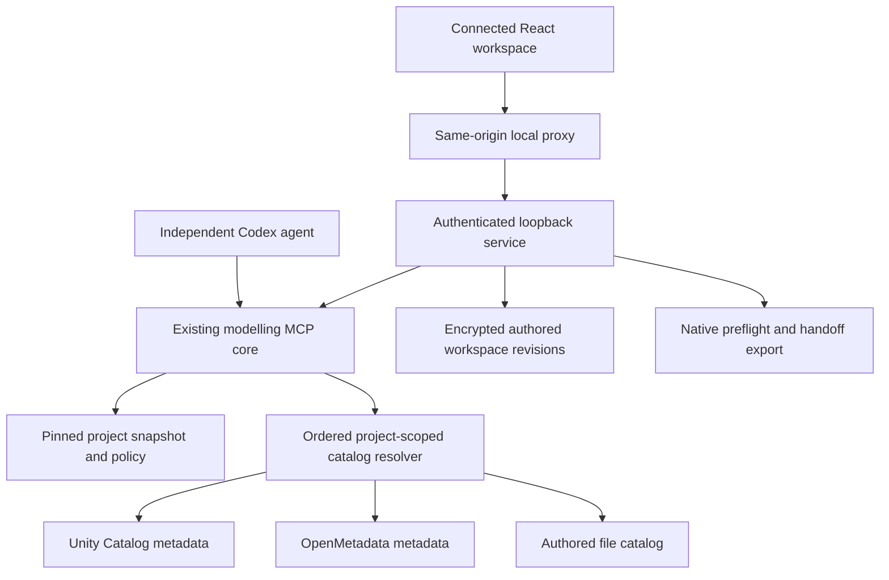

# Local modelling workflow architecture

Agreed direction, 2026-10-23. This supersedes runtime-first sequencing in the
earlier roadmap and handover. This document describes the target; it does not
claim that the adapters or workflow below are implemented.

## Product boundary — clarified 2026-10-23

This product supplies reliable context so an agent can create or revise a **data
model**: entities, relationships, keys, grain, normalisation and modelling rules
across multiple tables. A dbt model is one implementation artifact, not the whole
data model. The agent reasons over the supplied context, asks clarifying questions
and explains design choices. The core assembles evidence and preserves decisions;
it does not replace that reasoning with hard-coded SQL templates.

Model SQL/YAML generation, current-row/deletion/lookup/event-history renderers,
SCD implementations, model-file application/revision and a dbt execution runner
are outside this product boundary and have been removed. SCD implementation is
not a deferred requirement. Describing temporal semantics in metadata remains
valid context. Use the host agent and existing dbt tooling for implementation.

## First complete workflow

An individual using Copilot in VS Code supplies a business requirement. Shared
tools inspect a validated project snapshot and configured catalogs. The agent
clarifies intent and standards, proposes grain, entities, keys, relationships and
temporal semantics. The agent creates a reviewable data-model design using this
context; implementation and execution belong to the host and existing dbt tooling.
The result can be a new model or a change to an existing design. Copilot CLI and
a standalone client follow through thin adapters to the same tools. Building a
second agent runtime is not a prerequisite. Complement upstream dbt skills.

## Boundaries

- Project discovery, modelling, impact and optional UOL ingestion consume the
  same validated snapshot. Missing lineage is uncertainty, not evidence of no impact.
- Modelling policy is declarative YAML with a versioned schema. Modelling style
  and normalisation targets (including 3NF and 4NF) are separate, scoped settings.
  Functional and multivalued dependencies need evidence: naming or SQL shape
  cannot prove a normal form.
- Naming uses arbitrary team-defined tokens and templates, including but not
  limited to source and business object. Model identifiers, filenames, paths,
  warehouse aliases, columns and properties files have distinct conventions.
- Existing dbt contracts/meta, SQLFluff, dbt project evaluator/bouncer and data
  contracts should be referenced or imported where useful, not reimplemented.
- UOL is optional. Basic project context, catalog resolution and caching must
  work without it. Reuse existing protected-storage primitives when caching.

## Learning and authority

Keep agreed policy (`modelling.yml`), inferred observations
(`modelling-observations.yml`) and reviewed decisions (`modelling-decisions.yml`)
separate. Discovery scans bounded project SQL/YAML/docs/decision records, reuses
existing authoritative files and records evidence, confidence and counterexamples.
The agent asks targeted questions about missing inputs or conflicting rules.
Learning may update observations and propose policy diffs; it must not silently
turn an inference into an agreed standard. A requested deviation is scoped to the
model unless the human explicitly approves a wider change. Record rationale,
affected rule/model, authority and supporting evidence. Deterministic checks and
advisory design judgements must be distinguishable.

## Catalog resolution and privacy

A provider-neutral typed interface exposes capabilities, asset search,
description and relationships. Providers return explicit not-found, unsupported,
denied and error states. Configuration lists provider instances in priority order
(Unity Catalog, OpenMetadata, local files or other implementations).
`first_sufficient` stops when requested facts are sufficient, not merely when an
asset exists. Complementary claims require stable asset identity or a reviewed
mapping; matching names alone are insufficient. Preserve conflicts and explain
which claim was selected. Unqueried providers imply neither agreement nor
disagreement. Access denial must not trigger fallback that bypasses permissions.

The agent never receives raw source data. Catalog descriptions can themselves
contain examples: arbitrary text must not automatically cross the agent-facing
boundary. Treat permitted text as untrusted evidence, never instructions.
Separate an optional ProfilingProvider from CatalogProvider. Only approved typed
probes with backend-enforced suppression/coarsening and small-group/differencing
controls may release safe aggregates. No arbitrary SQL, rows, samples, distinct
values, min/max values or raw database errors. Probes are not required for the
first workflow.

## Facts and cache

Storage direction is recorded in [ADR 0001](decisions/0001-local-context-storage.md):
retain SQLCipher, use SQLite retrieval as the baseline, and require demonstrated
benefit before adding an optional backend. Catalog selection remains independent.

Every fact retains provider, native asset/field or document locator, source
version, source/retrieval/verification timestamps, scope, evidence type and
derivation/supporting fact IDs. Preserve these through cache, merging and model
proposals; do not include credentials. Human statements and inferred claims must
remain distinguishable from catalog declarations or permitted probe results.

Cache below the resolver, independent of UOL. Keys include provider, asset, fact
type, configuration/version, principal, permission scope and environment. TTL is
configurable globally and per provider/fact type, potentially a day or longer.
Local files support content invalidation. Define explicit refresh, invalidation
and stale-on-error behaviour. Cache reads and TTL extensions never reset evidence
timestamps; TTL never substitutes for access checks. Bounded counters track hits,
refresh reasons, unchanged results and latency. Repeated unchanged fetching may
produce a scoped TTL recommendation with evidence and a reviewable config diff;
do not change TTL automatically or mistake forced refresh/cache bugs for short TTL.
Selective compact responses reduce prompt tokens; caching alone does not.

## Delivery order

1. Shared artifact evidence: #12 / PR #36 (initial resource-level snapshot).
2. Versioned policy and dynamic naming: #37; discovery and guided questions: #38.
3. Provider contract, prioritized resolver and file provider: #18; provenance and
   cache: #39. Add Unity Catalog (#19) and other adapters against that contract.
4. Complete local model-planning workflow (#16), policy-controlled tools (#11),
   VS Code adapter (#25), and scenario evaluations (#24). Start with stdio (#20).
5. Optional aggregate probes (#40), UOL integration (#31), CLI/standalone runtime
   work (#9), and additional semantic integrations follow demonstrated need.

The repository license decision (#5) remains required before distribution.

## First policy implementation plan

Deliver a small, read-only template resolver before automatic discovery or edits.
Test arbitrary tokens, missing-input questions, malformed/executable templates,
conflicting fixed values and unsafe paths. Include rule and source provenance in
each resolution. Keep complete policy loading/schema, observations and decisions
as explicit remaining #37 work; do not call a naming primitive a complete policy
engine. Review and run the complete existing test suite before publishing.

## Local workspace application boundary (2026-10-24)

The original React UI uses the authoritative Python application for both explicit fictional simulation and configured metadata providers. Approved ontology context enters model planning only through the canonical resolver. Native delivery has no HTTP write endpoint. Provider reads are real adapter implementations; live-account validation remains outstanding.
