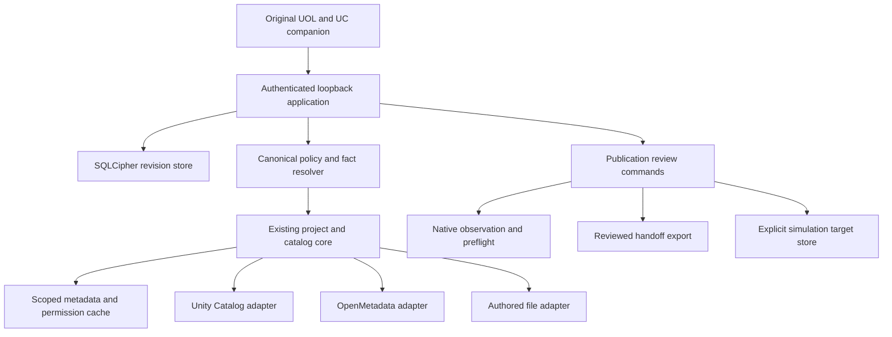
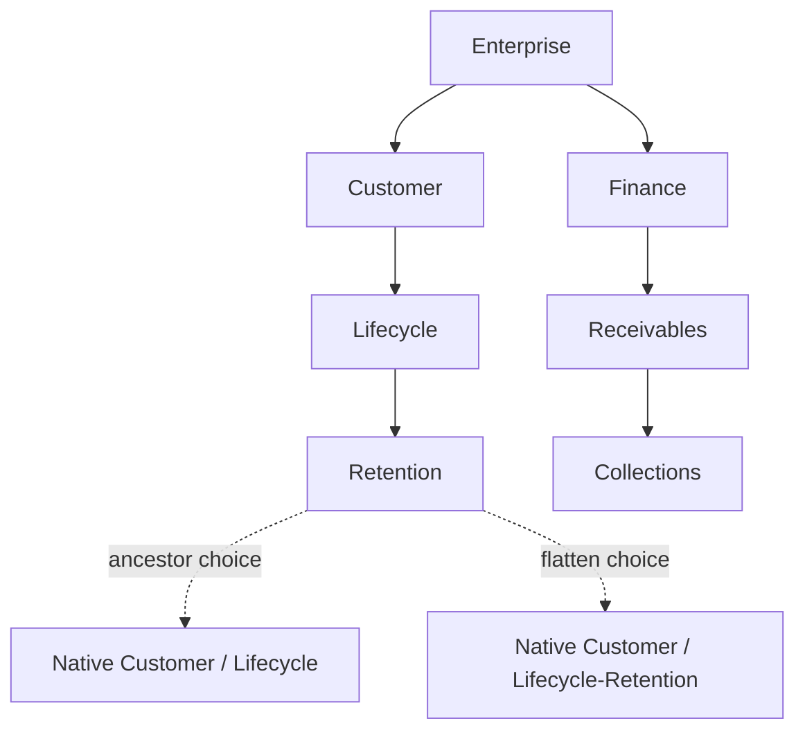
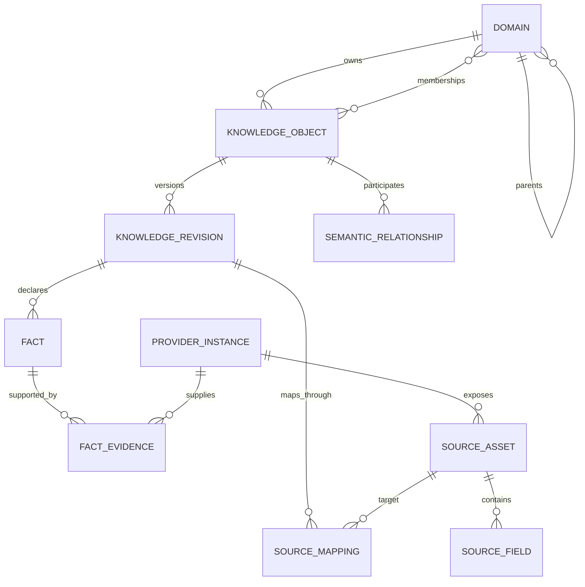
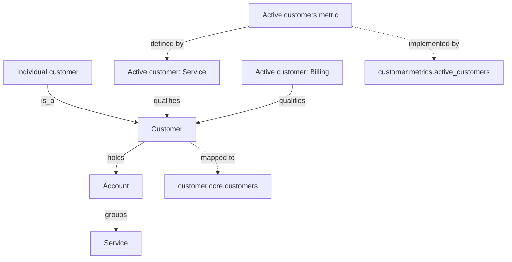
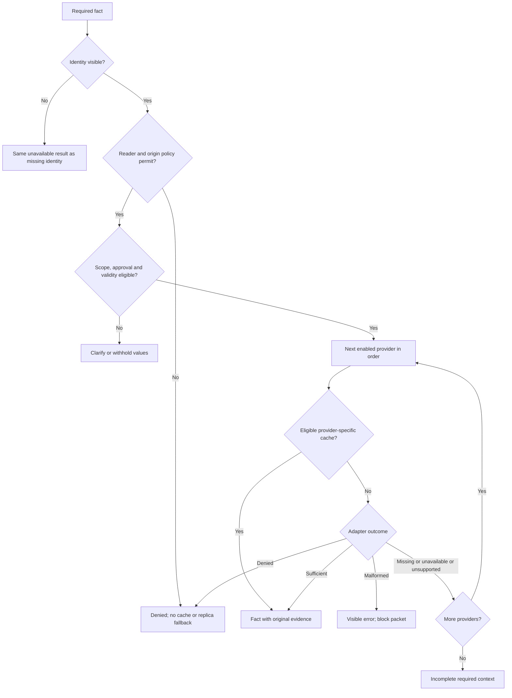
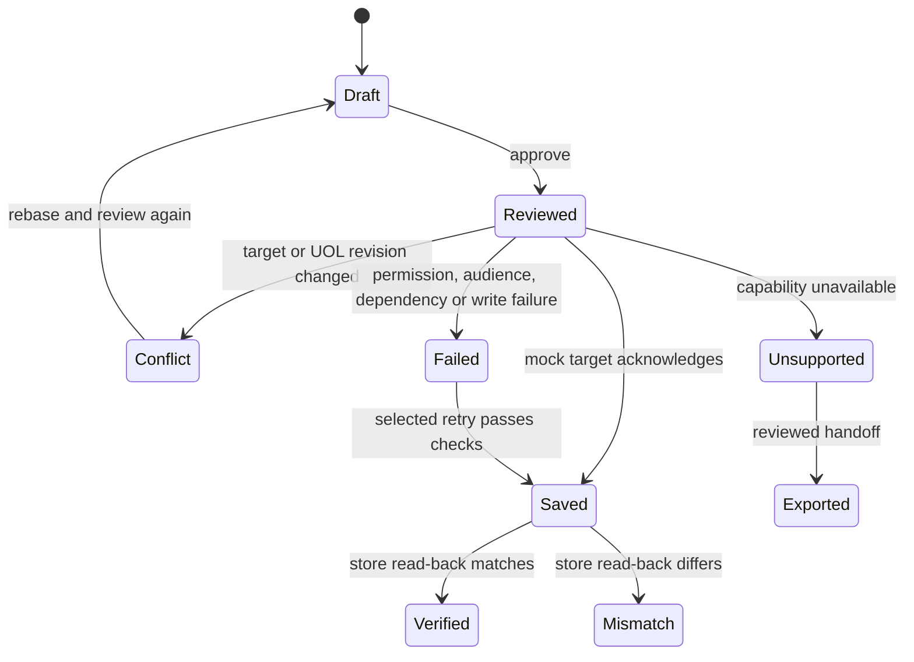
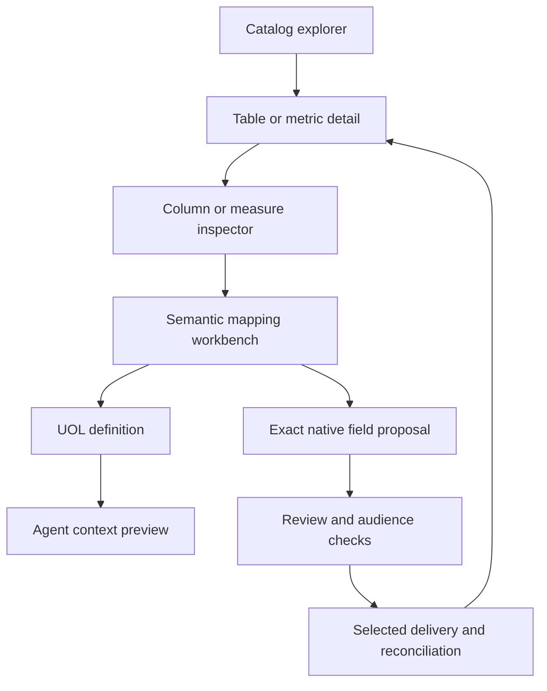

# Application architecture

The original React/Vite/React Flow workspace is retained. Authoritative application commands, context resolution and persistence now run in Python. The UI has no provider credentials or silent fixture fallback. An explicit server-selected fictional mode exercises the same command and storage contracts.

Provider and native interfaces permit metadata only. Original screens send named commands and expected repository revisions. Server filtering precedes snapshots and exports. Model planning reuses canonical resolution for approved mapped ontology evidence. Real native delivery is disabled; preflight/readback are separate from save acknowledgement. Editing and import are atomic and revision checked. No browser state constitutes authority. Real source snapshots retain separate relation/column provenance; current permission and source identity/revision gate dependent facts, observations and exports. Cache identity includes the actual document/locator, and provider-level TTL follows the selected fact provider.

# Domain hierarchy and projection

A third choice retains the hierarchy only in UOL. Dotted edges are alternative
projections, not multiple parents. Stable UOL ID and full path are exported. Native
parent/subdomain governed-tag keys are explicit. A Page's UOL owner domain never moves
as a side effect. Projection is proposed as a tags change, not an invented native
ontology field. Collision detection is limited to the fictional domain inventory.

# Semantic model and evidence

`contracts.ts` defines the records, scoped definitions, evidence, cache observations,
resolution results, target observations, proposals and delivery attempts. Approval,
origin, confidence, authority, freshness, validity and reader policy are separate.
Mappings store `assetId` and `fieldPath` separately. Provider/native IDs disambiguate
identical fully qualified names. Delivery stores original semantic IDs and revisions;
read-back does not create a second fact or increase confidence.

# Typed relationships

Graph type colors, dashed semantic/mapping edges, inspectable direction and a keyboard
list distinguish relationships. A separate contract-line part_of edge demonstrates
composition. Native lineage never becomes a declared business relationship.

# Resolution of one fact

The cache check is provider-specific inside ordered traversal so reordering providers
cannot silently select old lower-priority evidence. Reader/origin policy precedes all
cache use. Cache keys include semantic revision, fact, scope, provider, reader, policy
and configuration versions. In this small demo configuration changes conservatively
clear all provider cache entries; human-owned revisions/decisions remain untouched.

TTL order: object override, nearest explicit domain override, provider default,
workspace 24h. Enterprise has no explicit TTL override. Cache reads retain original
observation times. Recommendations require at least three actual same-fact retrievals
within one mock hour and only apply after acceptance.

# Publication states

Checks run synchronously in this mock. Saved is an intermediate state reflected in
acknowledgement receipts. Indexing and answer use remain unknown. Full Genie conflicts
must reopen the complete target snapshot; simple field rebase returns to Draft.

# Catalog-to-publication journey

